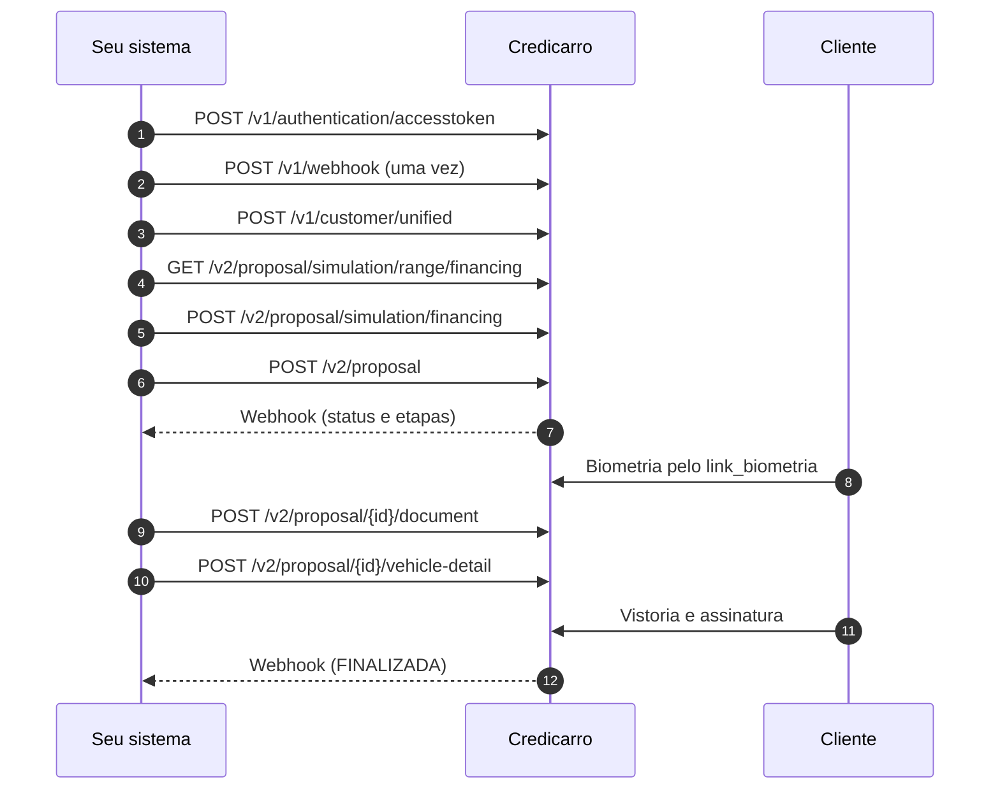

Este guia leva uma proposta de **financiamento** do começo ao fim no staging. Cada passo traz a requisição e a resposta.

<Info>
  Antes de começar, tenha as credenciais de staging e um `cnpjLoja` vinculado ao seu cadastro. Veja [Ambiente de testes](/pages/development). Os valores dos exemplos são ilustrativos.
</Info>

## Visão geral



Nos exemplos, `$BASE` é `https://api.staging.credicarro.com.br/integration` e `$TOKEN` é o token de acesso.

---

<Steps>
  <Step title="Gere o token">
    ```bash
    curl -X POST $BASE/v1/authentication/accesstoken \
      -H "Content-Type: application/json" \
      -d '{ "clientId": "<client-id>", "clientSecret": "<client-secret>" }'
    ```

    Guarde `token_de_acesso` e reaproveite até perto de `expira_em`. Veja [Autenticação](/pages/authentication).
  </Step>

  <Step title="Cadastre o webhook de proposta (uma vez)">
    ```bash
    curl -X POST $BASE/v1/webhook \
      -H "Authorization: Bearer $TOKEN" \
      -H "Content-Type: application/json" \
      -d '{
        "tipo": 3,
        "url": "https://parceiro.com.br/webhooks/credicarro",
        "tipo_autenticacao": 3,
        "credencial": "<token-que-seu-endpoint-espera>"
      }'
    ```

    ```json Resposta (201)
    {
      "id_webhook": "3fa85f64-5717-4562-b3fc-2c963f66afa6",
      "segredo_assinatura": "<segredo-de-assinatura>"
    }
    ```

    <Warning>
      O `segredo_assinatura` só aparece nesta resposta. Guarde-o para validar as notificações.
    </Warning>
  </Step>

  <Step title="Cadastre o cliente com dados completos">
    A proposta só é aceita com dados pessoais, endereço, ocupação e renda. O endpoint unificado envia tudo de uma vez. Sem `Idempotency-Key`, chamar de novo com o mesmo CPF atualiza o cadastro.

    ```bash
    curl -X POST $BASE/v1/customer/unified \
      -H "Authorization: Bearer $TOKEN" \
      -H "Content-Type: application/json" \
      -d '{
        "cpf": "12345678901",
        "nome": "Maria",
        "sobrenome": "Souza",
        "email": "maria.souza@exemplo.com.br",
        "celular": "+55 (11) 99876-5432",
        "dataDeNascimento": "1990-05-20T00:00:00-03:00",
        "endereco": {
          "rua": "Av. Paulista",
          "numero": "1578",
          "complemento": "Bloco B, Apto 1203",
          "bairro": "Bela Vista",
          "cidade": "São Paulo",
          "estado": "SP",
          "cep": "01311000"
        },
        "dadosProfissionais": { "tipoOcupacao": 3, "renda": 6500.00 }
      }'
    ```

    ```json Resposta (200)
    { "id_cliente": "123e4567-e89b-12d3-a456-426614174000" }
    ```
  </Step>

  <Step title="Consulte a entrada mínima (opcional)">
    ```bash
    curl "$BASE/v2/proposal/simulation/range/financing?placa=ABC1D23&cnpjLoja=11222333000181" \
      -H "Authorization: Bearer $TOKEN"
    ```

    ```json Resposta (200)
    {
      "opcoes_por_prazo": [
        { "prazo": 24, "valor_minimo_entrada": 4500.00 },
        { "prazo": 36, "valor_minimo_entrada": 5000.00 },
        { "prazo": 48, "valor_minimo_entrada": 6750.00 }
      ]
    }
    ```

    Use a resposta para orientar o valor de entrada antes de simular.
  </Step>

  <Step title="Simule">
    ```bash
    curl -X POST $BASE/v2/proposal/simulation/financing \
      -H "Authorization: Bearer $TOKEN" \
      -H "Content-Type: application/json" \
      -H "Idempotency-Key: $(uuidgen)" \
      -d '{
        "cpf": "12345678901",
        "placa": "ABC1D23",
        "valorVeiculo": 45000,
        "valorEntrada": 5000,
        "uf": "SP",
        "isVeiculoZeroKm": false,
        "cnpjLoja": "11.222.333/0001-81"
      }'
    ```

    ```json Resposta (201)
    {
      "simulacoes": [
        {
          "id_simulacao": "123e4567-e89b-12d3-a456-426614174000",
          "valor_solicitado": 40000,
          "prazo": 36,
          "valor_parcela": 1890.55,
          "valor_tac": 1500,
          "valor_boleto": 3.5,
          "valor_seguro": 0,
          "valor_iof": 872,
          "percentual_iof": 1.92,
          "valor_credito_total": 42372,
          "valor_divida_total": 68059.8,
          "percentual_cet_mensal": 3.62,
          "percentual_cet_anual": 53.25,
          "percentual_juros_mensal": 3.29,
          "percentual_juros_anual": 47.53,
          "valor_retencao_diaria_aproximado": null
        }
      ]
    }
    ```

    A resposta traz **uma simulação por prazo**. Mostre as opções ao cliente e guarde o `id_simulacao` escolhido. Veja [Simulação](/pages/v2/simulation/reference).
  </Step>

  <Step title="Crie a proposta">
    ```bash
    curl -X POST $BASE/v2/proposal \
      -H "Authorization: Bearer $TOKEN" \
      -H "Content-Type: application/json" \
      -H "Idempotency-Key: $(uuidgen)" \
      -d '{ "cpf": "12345678901", "simulacaoId": "123e4567-e89b-12d3-a456-426614174000" }'
    ```

    ```json Resposta (201)
    { "id_proposta": "bea8d060-f93d-48eb-b6c4-45f64483cdd9" }
    ```

    Guarde o `id_proposta`. A partir daqui, a proposta avança pelas etapas.
  </Step>

  <Step title="Acompanhe pelo webhook">
    A cada mudança, a Credicarro envia o [webhook de proposta](/pages/v2/webhooks) com o retrato da proposta. Para cada participante (`comprador` e `loja`), olhe o `status_ativo`:

    | `responsavel_acao` | O que fazer |
    | --- | --- |
    | `INTEGRADOR` | Chame o endpoint da `etapa` (tabela abaixo). |
    | `CLIENTE` | Oriente o cliente. Na `ANALISE_BIOMETRIA`, envie a ele o `link_biometria` da [consulta da proposta](/pages/v2/proposal/get). |
    | `CREDICARRO` | Aguarde. |
    | `NENHUM` | A proposta foi encerrada. |

    | `etapa` | Endpoint |
    | --- | --- |
    | `ENVIO_DOCUMENTOS` / `CORRECAO_DOCUMENTOS` | [`POST /v2/proposal/{id}/document`](/pages/v2/proposal/document) |
    | `DADOS_VEICULO` | [`POST /v2/proposal/{id}/vehicle-detail`](/pages/v2/proposal/vehicle-detail) |
  </Step>

  <Step title="Envie os documentos">
    Um documento por chamada, em Base64, com `Idempotency-Key` obrigatória.

    ```bash
    curl -X POST $BASE/v2/proposal/bea8d060-f93d-48eb-b6c4-45f64483cdd9/document \
      -H "Authorization: Bearer $TOKEN" \
      -H "Content-Type: application/json" \
      -H "Idempotency-Key: doc-bea8d060-comprador-cnh-1" \
      -d '{
        "participante": "COMPRADOR",
        "tipoDocumento": 1,
        "nomeArquivo": "cnh-comprador.pdf",
        "conteudoBase64": "JVBERi0xLjcKJcOkw7zDtsOfCjIgMCBvYmoK..."
      }'
    ```

    Veja o [guia de envio de documentos](/pages/guides/document-upload) para tipos, limites e correção.
  </Step>

  <Step title="Informe os dados do veículo">
    Quando a etapa ativa for `DADOS_VEICULO`:

    ```bash
    curl -X POST $BASE/v2/proposal/bea8d060-f93d-48eb-b6c4-45f64483cdd9/vehicle-detail \
      -H "Authorization: Bearer $TOKEN" \
      -H "Content-Type: application/json" \
      -d '{
        "renavam": "12345678901",
        "chassi": "9BWZZZ377VT004251",
        "placa": "ABC1D23",
        "cor": "PRATA"
      }'
    ```

    Resposta: `202 Accepted`.
  </Step>

  <Step title="Aguarde vistoria, assinatura e pagamento">
    O cliente faz a vistoria e assina o contrato. Depois do pagamento, a proposta chega a `FINALIZADA` e o `responsavel_acao` passa a `NENHUM`.
  </Step>
</Steps>

---

## Erros comuns neste fluxo

| `tipo` | Passo | Como resolver |
| --- | --- | --- |
| `Customer.Account.NotFound` | Simulação | Cadastre o cliente antes de simular. |
| `Store.Integration.NotFound` | Faixa ou simulação | Confira o `cnpjLoja` e o vínculo da loja com o seu cadastro. |
| `Store.Integration.Intermediation` | Faixa ou simulação | Use outra loja ou fale com o time Credicarro. |
| `Customer.Account.Incomplete` | Proposta | Complete endereço, ocupação e renda em `/v1/customer/unified`. |
| `Simulation.Access.NotFromStore` | Proposta | Use um `id_simulacao` de uma simulação feita com `cnpjLoja`. |
| `Document.InvalidProposalStage` | Documentos | Envie só quando a etapa ativa for `ENVIO_DOCUMENTOS` ou `CORRECAO_DOCUMENTOS`. |

<Card title="Todos os códigos" icon="triangle-exclamation" href="/pages/errors" horizontal>
  Veja o formato de erro e a lista completa de códigos.
</Card>
