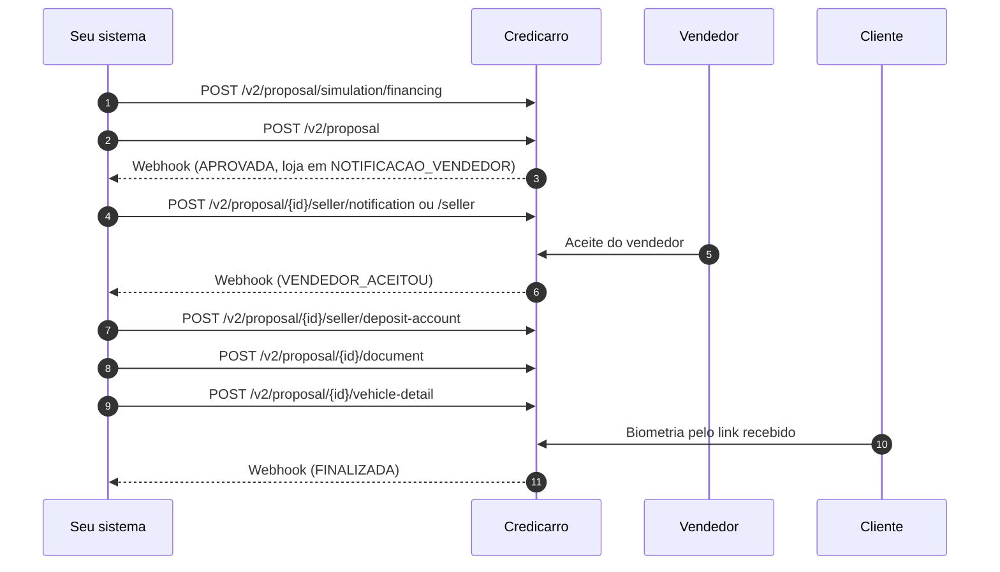

A intermediação é um financiamento feito em uma loja com contrato de intermediação. Quem vende o veículo é um terceiro, o **vendedor**: uma pessoa física ou um lojista. O fluxo segue o do [financiamento](/pages/guides/financing-integration), com três diferenças:

<CardGroup cols={3}>
  <Card title="Aceite do vendedor" icon="handshake">
    Depois da aprovação, o vendedor precisa aceitar a proposta.
  </Card>
  <Card title="Etapas do vendedor" icon="user-tag">
    O vendedor tem as próprias etapas: conta de recebimento, documentos e dados do veículo.
  </Card>
  <Card title="Loja sem envios" icon="store">
    A loja não envia documentos nem dados do veículo.
  </Card>
</CardGroup>

<Info>
  Os passos de token, webhook e cadastro do cliente são iguais aos do [guia de financiamento](/pages/guides/financing-integration). Só o financiamento aceita intermediação: no refinanciamento, a API retorna `422` com `Store.Integration.Intermediation`. Os valores dos exemplos são ilustrativos.
</Info>

## Visão geral



Nos exemplos, `$BASE` é `https://api.staging.credicarro.com.br/integration` e `$TOKEN` é o token de acesso.

---

## Modos de notificação

A Credicarro configura o modo de notificação da sua organização. Ele define quem avisa o vendedor e quem registra a decisão dele.

| Modo | Quem avisa o vendedor | Como o vendedor decide | Rotas |
| --- | --- | --- | --- |
| **Notificação pela Credicarro** | A Credicarro | Pelo convite que recebe da Credicarro | [`/seller/notification`](/pages/v2/proposal/seller-notification) **ou** [`/seller`](/pages/v2/proposal/seller) |
| **Notificação própria** | Você | Você registra a decisão pela API | [`/seller`](/pages/v2/proposal/seller) e depois [`/seller/decision`](/pages/v2/proposal/seller-decision) |

<Note>
  Na notificação pela Credicarro, use uma das duas rotas, não as duas. Depois de uma, a outra é recusada com `422`. Se você não souber o modo da sua organização, fale com o time Credicarro.
</Note>

---

<Steps>
  <Step title="Simule e crie a proposta">
    Simule com o `cnpjLoja` da loja de intermediação e crie a proposta, como no [guia de financiamento](/pages/guides/financing-integration). Na [consulta da proposta](/pages/v2/proposal/get), `intermediacao` vem `true`.
  </Step>

  <Step title="Aguarde a aprovação">
    Com a proposta aprovada, a etapa ativa da loja passa a `NOTIFICACAO_VENDEDOR` (3), com `responsavel_acao` = `INTEGRADOR`.

    ```json
    {
      "loja": {
        "cnpj": "11222333000181",
        "status_ativo": {
          "enum_etapa": 3,
          "etapa": "NOTIFICACAO_VENDEDOR",
          "enum_situacao": 1,
          "situacao": "AGUARDANDO_ENVIO",
          "enum_responsavel_acao": 2,
          "responsavel_acao": "INTEGRADOR"
        }
      }
    }
    ```
  </Step>

  <Step title="Avise o vendedor">
    <Tabs>
      <Tab title="Notificação pela Credicarro">
        Peça à Credicarro que convide o vendedor:

        ```bash
        curl -X POST $BASE/v2/proposal/bea8d060-f93d-48eb-b6c4-45f64483cdd9/seller/notification \
          -H "Authorization: Bearer $TOKEN" \
          -H "Content-Type: application/json" \
          -d '{
            "tipo_pessoa": "FISICA",
            "email": "vendedor@exemplo.com",
            "celular": "+55 (11) 99999-9999"
          }'
        ```

        Resposta: `202 Accepted`. O vendedor aceita ou recusa pelo convite.

        Se você já tem os dados do vendedor, pode usar [Informar o vendedor](/pages/v2/proposal/seller) no lugar desta rota. A Credicarro também convida o vendedor.
      </Tab>
      <Tab title="Notificação própria">
        Informe o vendedor:

        ```bash
        curl -X POST $BASE/v2/proposal/bea8d060-f93d-48eb-b6c4-45f64483cdd9/seller \
          -H "Authorization: Bearer $TOKEN" \
          -H "Content-Type: application/json" \
          -d '{
            "tipo_pessoa": "FISICA",
            "nome": "Maria da Silva",
            "cpf": "98765432100",
            "email": "vendedor@exemplo.com",
            "celular": "+55 (11) 99999-9999"
          }'
        ```

        Resposta: `201 Created`. Avise o vendedor pelo seu canal e registre a decisão:

        ```bash
        curl -X POST $BASE/v2/proposal/bea8d060-f93d-48eb-b6c4-45f64483cdd9/seller/decision \
          -H "Authorization: Bearer $TOKEN" \
          -H "Content-Type: application/json" \
          -d '{ "decisao": "ACEITO" }'
        ```

        Resposta: `204 No Content`.
      </Tab>
    </Tabs>

    <Warning>
      O vendedor pessoa física precisa estar cadastrado antes em [`POST /v1/customer/unified`](/pages/customer/unified), e não pode ser o comprador. Para o lojista, envie `tipo_pessoa` = `JURIDICA` e `cnpj` no lugar de `cpf`.
    </Warning>
  </Step>

  <Step title="Acompanhe a decisão">
    Com o vendedor informado, `vendedor` aparece na consulta com a etapa `ACEITE_VENDEDOR` (13) e `decisao` = `INFORMADO`.

    | Decisão | O que acontece | `motivo_evento` do webhook |
    | --- | --- | --- |
    | Aceite | `decisao` passa a `ACEITO` e o vendedor segue para `CONTA_RECEBIMENTO`. | `VENDEDOR_ACEITOU` |
    | Recusa | O vendedor informado é removido e a loja volta a `NOTIFICACAO_VENDEDOR`. Informe outro vendedor. | `VENDEDOR_RECUSOU` |
  </Step>

  <Step title="Envie o que a etapa do vendedor pedir">
    As etapas do vendedor dependem do tipo de pessoa. Quando `responsavel_acao` for `INTEGRADOR`, chame o endpoint da etapa:

    <Tabs>
      <Tab title="Pessoa física">
        | Ordem | `etapa` | Endpoint |
        | --- | --- | --- |
        | 1 | `CONTA_RECEBIMENTO` | [`POST /v2/proposal/{id}/seller/deposit-account`](/pages/v2/proposal/seller-deposit-account) |
        | 2 | `ENVIO_DOCUMENTOS` | [`POST /v2/proposal/{id}/document`](/pages/v2/proposal/document), com `participante` = `VENDEDOR` |
        | 3 | `DADOS_VEICULO` | [`POST /v2/proposal/{id}/vehicle-detail`](/pages/v2/proposal/vehicle-detail) |
        | 4 | `VISTORIA` | Vistoria do veículo |
        | 5 | `ANALISE_BIOMETRIA` | Biometria do vendedor |
      </Tab>
      <Tab title="Lojista">
        | Ordem | `etapa` | Endpoint |
        | --- | --- | --- |
        | 1 | `CONTA_RECEBIMENTO` | [`POST /v2/proposal/{id}/seller/deposit-account`](/pages/v2/proposal/seller-deposit-account) |
        | 2 | `DADOS_VEICULO` | [`POST /v2/proposal/{id}/vehicle-detail`](/pages/v2/proposal/vehicle-detail) |
        | 3 | `ENVIO_DOCUMENTOS` | [`POST /v2/proposal/{id}/document`](/pages/v2/proposal/document), com `participante` = `VENDEDOR` |
        | 4 | `DADOS_EMPRESA` | [`POST /v2/proposal/{id}/seller/company`](/pages/v2/proposal/seller-company) |
        | 5 | `PAGAMENTO` | A Credicarro conclui o pagamento |
      </Tab>
    </Tabs>

    ```bash
    curl -X POST $BASE/v2/proposal/bea8d060-f93d-48eb-b6c4-45f64483cdd9/seller/deposit-account \
      -H "Authorization: Bearer $TOKEN" \
      -H "Content-Type: application/json" \
      -d '{
        "documentoTitular": "98765432100",
        "codigoBanco": "001",
        "agencia": "1234",
        "digitoAgencia": "5",
        "conta": "123456",
        "digitoConta": "7",
        "tipoConta": "CORRENTE"
      }'
    ```

    Os documentos exigidos do vendedor estão em [Etapas e status](/pages/v2/steps#documentos-exigidos-na-consulta).
  </Step>

  <Step title="Biometria do vendedor pessoa física">
    Na notificação própria, a Credicarro cria a sessão de biometria do vendedor pessoa física e não envia o link a ele. Repasse ao vendedor o `vendedor.link_biometria` da [consulta da proposta](/pages/v2/proposal/get).
  </Step>

  <Step title="Acompanhe o comprador">
    O comprador segue as etapas do financiamento: `ENVIO_DOCUMENTOS` e, por último, `ANALISE_BIOMETRIA`. Envie os documentos dele com `participante` = `COMPRADOR`. A Credicarro conclui o contrato e a proposta chega a `FINALIZADA`.
  </Step>
</Steps>

---

## Erros comuns neste fluxo

| `tipo` | Passo | Como resolver |
| --- | --- | --- |
| `Store.Integration.Intermediation` | Simulação ou proposta | O refinanciamento não aceita intermediação. Use o financiamento. |
| `Seller.Integration.NotInNotificationStep` | Aviso do vendedor | Aguarde a loja chegar a `NOTIFICACAO_VENDEDOR`. |
| `Seller.Integration.SelfManaged` | Aviso do vendedor | Sua organização usa notificação própria. Use `/seller` e `/seller/decision`. |
| `Seller.Integration.DecisionOnlySelfManaged` | Decisão | Na notificação pela Credicarro, o vendedor decide pelo convite. |
| `Seller.Integration.AccountRequired` | Aviso do vendedor | Cadastre o vendedor pessoa física em `/v1/customer/unified`. |
| `Seller.Integration.HolderMustBeCpf`, `Seller.Integration.HolderMustBeCnpj` | Conta do vendedor | Use uma conta no CPF do vendedor pessoa física ou no CNPJ do lojista. |
| `Seller.Integration.NotInDepositAccountStep` | Conta do vendedor | Envie só quando a etapa ativa do vendedor for `CONTA_RECEBIMENTO`. |

<Card title="Todos os códigos" icon="triangle-exclamation" href="/pages/errors" horizontal>
  Veja o formato de erro e a lista completa de códigos.
</Card>
