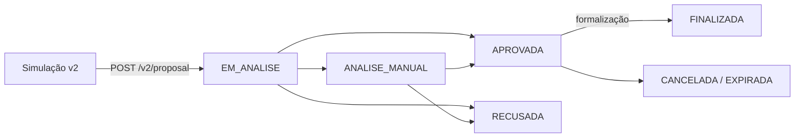

A **proposta** é o pedido de crédito, criado a partir de uma opção de simulação. Na v2, ela traz o status geral e, para cada participante (comprador e loja), a etapa ativa e quem precisa agir.

## Ciclo de vida



O diagrama mostra os caminhos mais comuns. A lista completa de status está em [Etapas e status](/pages/v2/steps).

## Endpoints

| Endpoint | Quando chamar |
| --- | --- |
| [`POST /v2/proposal`](/pages/v2/proposal/create) | Criar a proposta com o `id_simulacao` escolhido. |
| [`GET /v2/proposal/{propostaId}`](/pages/v2/proposal/get) | Consultar o retrato atual. |
| [`POST /v2/proposal/{propostaId}/document`](/pages/v2/proposal/document) | Etapa `ENVIO_DOCUMENTOS` ou `CORRECAO_DOCUMENTOS`. |
| [`POST /v2/proposal/{propostaId}/vehicle-detail`](/pages/v2/proposal/vehicle-detail) | Etapa `DADOS_VEICULO`. |
| [`POST /v2/proposal/{propostaId}/deposit-account`](/pages/v2/proposal/deposit-account) | Etapa `CONTA_RECEBIMENTO` (só refinanciamento). |
| [`GET /v1/proposal`](/pages/proposal/pagination) | Listar as propostas do parceiro. |

## Objeto proposta

```json GET /v2/proposal/{propostaId}
{
  "id_proposta": "bea8d060-f93d-48eb-b6c4-45f64483cdd9",
  "numero": 171020250001,
  "id_simulacao": "123e4567-e89b-12d3-a456-426614174000",
  "enum_status": 2,
  "status": "APROVADA",
  "tipo": "Financing",
  "data_criacao": "2026-10-12T14:05:08.984-03:00",
  "link_biometria": "https://onboarding.exemplo.com/sessao/abc123",
  "comprador": {
    "cpf": "12345678901",
    "enum_biometria": 1,
    "biometria": "SESSAO_CRIADA",
    "status_ativo": {
      "enum_etapa": 4,
      "etapa": "ANALISE_BIOMETRIA",
      "enum_situacao": 2,
      "situacao": "AGUARDANDO_CLIENTE",
      "enum_responsavel_acao": 1,
      "responsavel_acao": "CLIENTE"
    },
    "etapas_concluidas": [
      { "enum_etapa": 1, "etapa": "PROPOSTA_CRIADA", "data": "2026-10-12T14:05:08-03:00" },
      { "enum_etapa": 2, "etapa": "PROPOSTA_APROVADA", "data": "2026-10-12T14:06:40-03:00" }
    ],
    "documentos": []
  },
  "loja": {
    "cnpj": "11222333000181",
    "status_ativo": {
      "enum_etapa": 6,
      "etapa": "ENVIO_DOCUMENTOS",
      "enum_situacao": 1,
      "situacao": "AGUARDANDO_ENVIO",
      "enum_responsavel_acao": 2,
      "responsavel_acao": "INTEGRADOR"
    },
    "etapas_concluidas": [],
    "documentos": []
  }
}
```

| Campo | Descrição |
| --- | --- |
| `id_proposta` | Identificador da proposta. |
| `numero` | Número da proposta, útil para atendimento. |
| `id_simulacao` | Simulação que originou a proposta. |
| `enum_status` / `status` | Status geral. Veja [Etapas e status](/pages/v2/steps). |
| `tipo` | `Financing` (financiamento) ou `Refinancing` (refinanciamento). |
| `data_criacao` | Data de criação. |
| `motivo_recusa` | Motivo da recusa. Omitido quando vazio. |
| `link_biometria` | Link para o cliente fazer a biometria. Omitido quando vazio. |
| `comprador` | Biometria, etapa ativa, etapas concluídas e documentos do comprador. |
| `loja` | Etapa ativa, etapas concluídas e documentos da loja. Presente quando a proposta foi feita em loja. |

## Como decidir o próximo passo

Para **cada** participante (`comprador` e `loja`), leia `status_ativo`:

| `responsavel_acao` | `etapa` | O que fazer |
| --- | --- | --- |
| `INTEGRADOR` (2) | `ENVIO_DOCUMENTOS` (6) ou `CORRECAO_DOCUMENTOS` (7) | [Enviar documento](/pages/v2/proposal/document) |
| `INTEGRADOR` (2) | `DADOS_VEICULO` (8) | [Incluir dados do veículo](/pages/v2/proposal/vehicle-detail) |
| `INTEGRADOR` (2) | `CONTA_RECEBIMENTO` (5) | [Incluir conta de recebimento](/pages/v2/proposal/deposit-account) |
| `CLIENTE` (1) | qualquer | Orientar o cliente (biometria, vistoria ou assinatura) |
| `CREDICARRO` (3) | qualquer | Aguardar |
| `NENHUM` (0) | qualquer | Nada — a proposta foi encerrada |

<Tip title="Compare pelo número" horizontal>
  No seu sistema, prefira comparar `enum_etapa` e `enum_responsavel_acao` e usar os nomes em telas e logs.
</Tip>

<Note>
  Propostas criadas pela v1 não são aceitas pelas rotas `/v2/proposal/{propostaId}` e retornam `422` com `Proposal.Access.NotIntegrationV2`. Consulte-as por [`GET /v1/proposal/{propostaId}`](/pages/proposal/get).
</Note>
